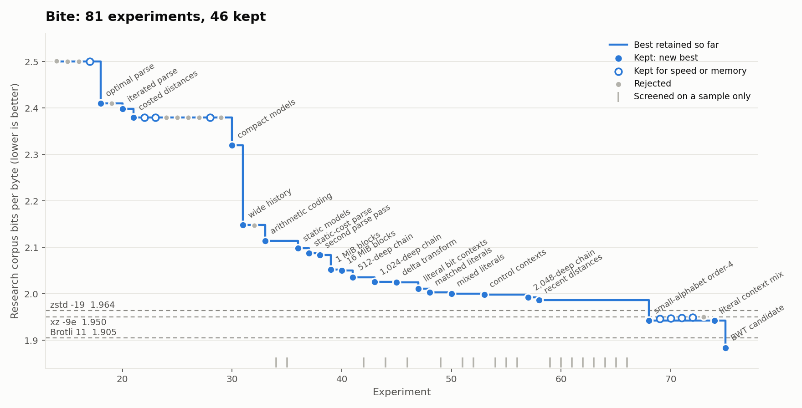
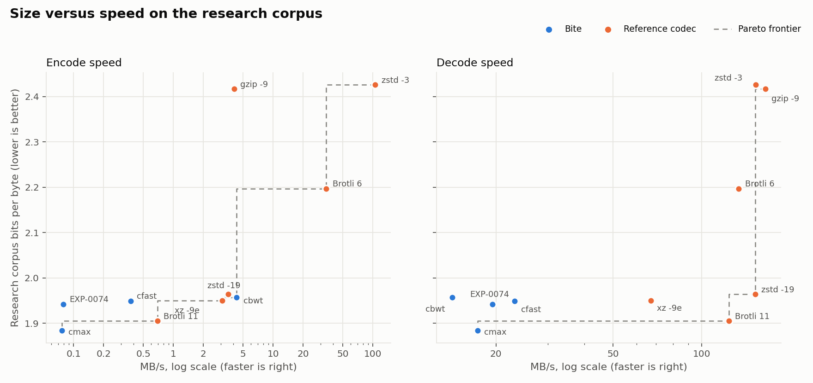

# Bite

Bite is a small lossless compressor written in C for controlled compression
experiments, not production use. Each idea is tested as a numbered experiment
against its parent, and only exact, measured improvements are kept.

<picture>
  <source media="(prefers-color-scheme: dark)" srcset="docs/progress-dark.png">
  
</picture>

## Results

Measured on the fixed public research corpus (16 Calgary and Canterbury Large
Corpus files, 13,787,888 bytes). Every row comes from one run on one idle M1
Mac: the same process harness, 3 repeats, all codecs single-threaded
([results](results/m1-2-timing-research/)).

| Codec | Bytes | Bits/byte | Encode | Decode |
|---|---:|---:|---:|---:|
| Bite `cmax` (EXP-0075) | 3,247,227 | 1.884 | 180.2 s | 0.79 s |
| Brotli 11 | 3,283,714 | 1.905 | 19.9 s | 0.11 s |
| Bite EXP-0074 (last validated size maximum) | 3,347,119 | 1.942 | 174.4 s | 0.71 s |
| Bite `cfast` (EXP-0072) | 3,359,272 | 1.949 | 36.9 s | 0.60 s |
| xz -9e | 3,360,808 | 1.950 | 4.5 s | 0.21 s |
| Bite `cbwt` (EXP-0075) | 3,373,378 | 1.957 | 3.2 s | 0.97 s |
| zstd -19 | 3,384,473 | 1.964 | 3.9 s | 0.09 s |

Against these practical codecs, `cbwt` is smaller than zstd -19 and faster to
encode, and `cmax` is the smallest but encodes 9 times slower than Brotli 11.
Every Bite preset decodes 3–11 times slower than they do.

**Stronger references beat Bite.** Block-sorting and context-mixing
compressors do much better on this corpus than the LZ codecs above. bzip2 -9
alone is smaller than `cbwt` and faster, and bsc is 7–8% smaller than `cmax`.
These sizes come from EXP-0080 (branch `exp-0080-references`) on a cloud
machine; same-machine timings are pending:

| Codec | Bytes | Bits/byte |
|---|---:|---:|
| zpaq -m5 | 2,806,383 | 1.628 |
| bsc (strongest settings) | 2,980,242 | 1.729 |
| bsc | 3,002,482 | 1.742 |
| PPMd (7-Zip -mx9) | 3,045,785 | 1.767 |
| bzip2 -9 | 3,364,810 | 1.952 |

These results are specific to this corpus and are not a claim that Bite is
generally better than any of these codecs.

<picture>
  <source media="(prefers-color-scheme: dark)" srcset="docs/pareto-dark.png">
  
</picture>

## Quick start

```sh
make
make corpus
make test
```

```sh
bin/bite cmax INPUT OUTPUT.bite   # smallest output, slowest
bin/bite cfast INPUT OUTPUT.bite  # about 3.5% larger, 5 times faster
bin/bite cbwt INPUT OUTPUT.bite   # BWT only; fast, but bzip2 -9 is smaller
bin/bite d OUTPUT.bite RESTORED   # decodes every mode
```

## How it works

- **LZ parsing.** A 16 MiB match window, a 2,048-deep hash-chain search and a
  dynamic-programming parser that prices matches with the entropy coder's
  actual costs.
- **Entropy coding.** Separate streams for literals, lengths, distances and
  control bits, each coded with Huffman or adaptive arithmetic coding and
  context models: previous bytes, match state, recent distances and a mix of
  order-1 to order-3 literal contexts.
- **Other representations.** A delta transform for structured data, an order-4
  model for small alphabets such as DNA, and a Burrows–Wheeler transform for
  text.
- **Exact selection.** Each block is encoded every way and the smallest
  complete payload wins, with raw storage as a fallback. Adding a mode can
  therefore never make a block larger.

## Research method

Every experiment starts with a written hypothesis, is screened on samples or
the frozen development corpus, is measured on the public research corpus, and
is recorded as kept or rejected along with its results. The Silesia corpus is
reserved for hold-out checks and not used for tuning.

- [experiments.csv](experiments.csv): one row per experiment, with its decision
- [research_memory.md](research_memory.md): what each experiment found
- [RESEARCH_PLAN.md](RESEARCH_PLAN.md): the current experiment and next steps
- [docs/benchmarking.md](docs/benchmarking.md): corpora and benchmark harnesses
- [docs/format.md](docs/format.md): the stream format and every mode
- `results/`: raw measurements for every run

Regenerate the charts with `python3 scripts/plot_progress.py` and
`python3 scripts/plot_pareto.py`.
